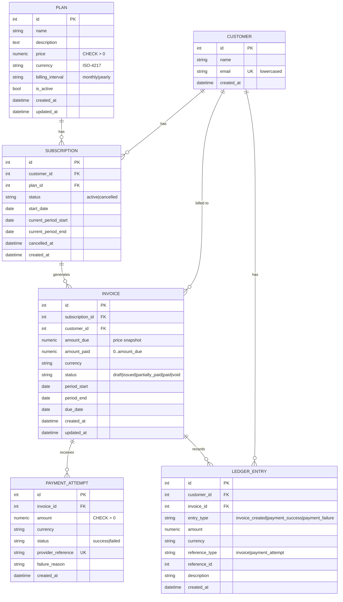
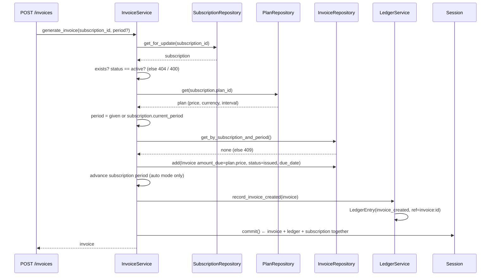

# SubLedger: Low-Level Design

## 1. Layered architecture

```
 HTTP request
     │
     ▼
┌───────────────┐  Pydantic schemas validate shape (types, gt=0, email, currency format)
│   Routes      │  app/api/routes/*   no business logic, no DB calls
└──────┬────────┘
       │ Depends(get_*_service)          app/api/deps.py (composition root)
       ▼
┌───────────────┐  Owns business rules and the transaction (commit)
│   Services    │  app/services/*
└──────┬────────┘
       │
       ▼
┌───────────────┐  Owns queries and persistence (add/flush/locks). No rules.
│ Repositories  │  app/repositories/*
└──────┬────────┘
       ▼
┌───────────────┐  Tables, FKs, unique/check constraints, relationships
│ Models / DB   │  app/models/*, app/db.py
└───────────────┘
```

Dependencies only point **downward**. Services raise `DomainError` subclasses (`NotFoundError`, `ConflictError`, `BusinessRuleError`). One exception handler in `main.py` maps them to HTTP, so routes contain no `try/except`.

## 2. ERD



### Constraints and indexes

| Table | Constraint | Purpose |
|---|---|---|
| `customers` | `UNIQUE(email)` | Email uniqueness (DB backstop) |
| `plans` | `CHECK(price > 0)` | Price rule (DB backstop) |
| `subscriptions` | partial `UNIQUE(customer_id, plan_id) WHERE status='active'` | One active subscription per plan; re-subscribing after cancel still works |
| `invoices` | `UNIQUE(subscription_id, period_start)` | No double-billing of a period |
| `invoices` | `CHECK(amount_paid BETWEEN 0 AND amount_due)` | Overpayment can't be stored even if a service bug slips through |
| `payment_attempts` | `UNIQUE(provider_reference)` | Idempotent payment recording |
| `ledger_entries` | `INDEX(reference_type, reference_id)` | Fast trace from source row to ledger |

### Fields added beyond the brief, and why

| Field | Why |
|---|---|
| `Plan.billing_interval` | Needed to calculate a billing period |
| `Plan.description`, `updated_at` | Usability and auditing of price changes |
| `Subscription.current_period_start/end` | The subscription knows which period to bill next, so auto-invoicing doesn't need extra input |
| `Subscription.cancelled_at` | Audit trail for cancellation |
| `Invoice.customer_id` | Denormalised so customer invoice listing and ledger writes don't need a join |
| `Invoice.updated_at` | Tracks when payment changed the invoice |
| `PaymentAttempt.failure_reason` | Required by the payment flow: failed payments store a reason |
| `LedgerEntry.reference_type` | `reference_id` alone is ambiguous (invoice 5 vs payment 5). Type + id is an unambiguous pointer |
| `LedgerEntry.invoice_id` | Lets you get an invoice's full history with one indexed query |

## 3. Service table

| Service | Responsibilities | Depends on |
|---|---|---|
| `PlanService` | Create/list/get/update plans; enforce `price > 0`; activate/deactivate | `PlanRepository` |
| `CustomerService` | Create/list/get customers; normalise email; enforce uniqueness | `CustomerRepository` |
| `SubscriptionService` | Create (plan active, no duplicate active), get, list, cancel; set first billing period | `SubscriptionRepository`, `CustomerRepository`, `PlanRepository` |
| `InvoiceService` | Generate invoice from subscription and plan price snapshot; calculate period and due date; prevent duplicate periods; advance subscription period; write ledger | `SubscriptionRepository`, `PlanRepository`, `InvoiceRepository`, `LedgerService` |
| `PaymentService` | Validate and record payment attempts; update `amount_paid`/status on success only; idempotency by `provider_reference`; write ledger | `InvoiceRepository`, `PaymentAttemptRepository`, `LedgerService` |
| `LedgerService` | **Only** writer of ledger entries; builds entries from invoices and attempts; queries; derives customer balances | `LedgerEntryRepository` |

## 4. Repository table

| Repository | Model | Methods |
|---|---|---|
| `BaseRepository[T]` | n/a | `get(id)`, `add(entity)` (add and flush), `list(offset, limit)` |
| `PlanRepository` | `Plan` | `list_plans(active_only)` |
| `CustomerRepository` | `Customer` | `get_by_email(email)` |
| `SubscriptionRepository` | `Subscription` | `get_for_update(id)`, `get_active_for_customer_and_plan(c, p)`, `list_for_customer(c)` |
| `InvoiceRepository` | `Invoice` | `get_for_update(id)`, `get_by_subscription_and_period(s, start)`, `list_invoices(filters)` |
| `PaymentAttemptRepository` | `PaymentAttempt` | `get_by_provider_reference(ref)`, `list_for_invoice(id)` |
| `LedgerEntryRepository` | `LedgerEntry` | `list_entries(filters)`, `sum_by_currency_and_type(customer)`. **No update or delete** |

Repositories **flush but never commit**, so several repository calls in one service method form one atomic unit of work.

## 5. Business-rule ownership

Each rule has one **owner** (the service, which is authoritative). Where it is cheap, there is also a first check in the schema and a backstop in the database.

| Rule | Owner (authoritative) | Also enforced by | Test |
|---|---|---|---|
| Plan price > 0 | `PlanService.create_plan/update_plan` | Schema `gt=0` → 422; DB `CHECK` | `test_plan_price_must_be_positive_*` |
| Customer email unique | `CustomerService.create_customer` | DB `UNIQUE` → 409 via IntegrityError handler | `test_customer_email_must_be_unique` |
| No subscription to inactive plan | `SubscriptionService.create_subscription` | n/a | `test_cannot_subscribe_to_inactive_plan` |
| One active subscription per (customer, plan) | `SubscriptionService.create_subscription` | DB partial unique index | `test_no_duplicate_active_subscription` |
| `amount_due` = plan price at generation | `InvoiceService.generate_invoice` | Stored as a snapshot column | `test_invoice_amount_comes_from_plan_price_snapshot` |
| Only active subscriptions are invoiced | `InvoiceService.generate_invoice` | n/a | `test_cannot_invoice_cancelled_subscription` |
| No duplicate invoice for a period | `InvoiceService.generate_invoice` | DB `UNIQUE(subscription_id, period_start)` | `test_cannot_invoice_same_period_twice` |
| Successful payment ≤ remaining | `PaymentService.record_payment` | DB `CHECK(amount_paid <= amount_due)` | `test_overpayment_is_rejected_and_not_recorded` |
| Full → `paid`, partial → `partially_paid` | `PaymentService.record_payment` | n/a | `test_partial_then_full_payment_updates_status` |
| Failed payment doesn't change `amount_paid` | `PaymentService.record_payment` | n/a | `test_failed_payment_does_not_change_amount_paid` |
| Payment currency = invoice currency | `PaymentService.record_payment` | n/a | `test_currency_must_match_invoice` |
| Idempotent payments | `PaymentService.record_payment` | DB `UNIQUE(provider_reference)` | `test_duplicate_provider_reference_is_rejected` |
| Ledger is append-only | `LedgerService` (only writer) + `LedgerEntryRepository` (no update/delete) | ORM `before_update`/`before_delete` hooks raise `LedgerImmutableError`; no write endpoints | `test_ledger_entries_cannot_be_updated_or_deleted`, `test_ledger_has_no_write_endpoints` |
| Ledger traceable through `reference_id` | `LedgerService.record_*` | Indexed `(reference_type, reference_id)` | `test_ledger_entries_trace_back_to_source` |

## 6. Design patterns

| Pattern | Where | Why |
|---|---|---|
| **Layered architecture** | routes → services → repositories → models | Each layer has one reason to change; business rules can be tested without HTTP |
| **Repository** | `app/repositories/` | Hides SQLAlchemy queries behind intent-named methods (`get_active_for_customer_and_plan`). Services read like the business rules they implement |
| **Generic base repository** | `BaseRepository[ModelT]` | `get`/`add`/`list` written once, with full typing |
| **Service layer** | `app/services/` | One place per aggregate for rules and orchestration |
| **Dependency injection** | Constructor injection + FastAPI `Depends` in `api/deps.py` | Services receive their collaborators, so tests can pass a different session or fake repositories. `deps.py` is the single composition root |
| **Unit of work (session per request)** | One `Session` shared by all repos in a request; the service calls `commit()` once | Invoice + ledger entry, or payment + invoice update + ledger entry, are saved atomically. `LedgerService` deliberately never commits |
| **Snapshot** | `Invoice.amount_due`, `Invoice.currency` | Later plan price edits can't rewrite history |
| **Append-only event log** | `LedgerEntry` | Ledger is the audit trail; balances are derived from it, not stored |
| **Exception translation** | `DomainError` hierarchy + one handler | Services stay HTTP-agnostic; responses are consistent |
| **Idempotency key** | `provider_reference` unique | Gateway retries/webhook replays can't double-count a payment |
| **Pessimistic locking** | `get_for_update()` on invoice and subscription | Prevents two concurrent payments both passing the "remaining amount" check (Postgres) |

## 7. Invoice generation flow



Steps:
1. Route receives `subscription_id` and an optional `period_start`/`period_end`. The schema checks that both or neither are given and that start < end.
2. `InvoiceService` fetches and locks the subscription through `SubscriptionRepository`.
3. It verifies the subscription exists (404) and is active (400).
4. It fetches the plan. The plan's **current** price and currency become the invoice snapshot.
5. It calculates the period (explicit, or the subscription's `current_period_*`) and `due_date = period_start + INVOICE_DUE_DAYS`. It rejects an already-billed period (409).
6. `InvoiceRepository.add` creates the invoice with status `issued`. In auto mode the subscription moves to the next period.
7. `LedgerService` writes an `invoice_created` entry (`reference_type=invoice`, `reference_id=invoice.id`).
8. A single commit saves everything. The route returns `InvoiceRead`.

## 8. Payment recording flow

```mermaid
sequenceDiagram
    participant R as POST /payments
    participant PS as PaymentService
    participant IR as InvoiceRepository
    participant PAR as PaymentAttemptRepository
    participant LS as LedgerService
    participant DB as Session

    R->>PS: record_payment(invoice_id, amount, currency, status, provider_reference)
    PS->>IR: get_for_update(invoice_id)
    IR-->>PS: invoice (else 404)
    PS->>PS: validate: payable status, currency, amount > 0
    PS->>PAR: get_by_provider_reference()
    PAR-->>PS: none (else 409)
    PS->>PS: success and amount > remaining? → 400
    PS->>PAR: add(PaymentAttempt)
    alt status == success
        PS->>PS: amount_paid += amount
        PS->>PS: status = paid if remaining == 0 else partially_paid
    else status == failed
        PS->>PS: keep failure_reason, invoice unchanged
    end
    PS->>LS: record_payment_attempt(attempt, invoice)
    LS->>LS: LedgerEntry(payment_success | payment_failure, ref=payment_attempt:id)
    PS->>DB: commit()
    PS-->>R: (attempt, invoice)
```

Steps:
1. Route receives `invoice_id, amount, currency, status, provider_reference, failure_reason?`.
2. `PaymentService` fetches and locks the invoice through `InvoiceRepository`.
3. It validates: invoice exists (404); invoice is `issued` or `partially_paid` (400); currency matches (400); `provider_reference` not seen before (409); for a success, `amount ≤ amount_due − amount_paid` (400). **Nothing is written if validation fails.**
4. `PaymentAttemptRepository.add` creates the attempt record.
5. **Failed:** store `failure_reason` (default `"unspecified"`). `amount_paid` and status don't change.
6. **Success:** increase `amount_paid`. Status becomes `paid` when nothing remains, otherwise `partially_paid`.
7. `LedgerService` writes `payment_success` or `payment_failure` (`reference_type=payment_attempt`, `reference_id=attempt.id`). A failure entry keeps the attempted amount for audit but never counts toward the balance.
8. A single commit. The route returns `{payment_attempt, invoice}`.

## 9. State machines

**Invoice:** `issued → partially_paid → paid`, or `issued → paid` directly. `paid` and `void` are terminal and reject payments. (`draft` and `void` are reserved for future manual flows.)

**Subscription:** `active → cancelled`. Cancelled subscriptions can't be invoiced. The customer can start a new active subscription to the same plan.

## 10. Testing strategy

- `tests/conftest.py` builds a fresh in-memory SQLite DB per test and overrides the `get_db` dependency, so every test runs against the real routes → services → repositories → DB path.
- 26 tests cover every rule in section 5. The append-only test goes straight to the ORM session to show the guard holds even outside the API.
